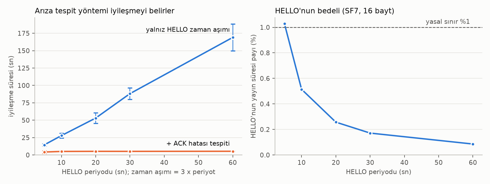
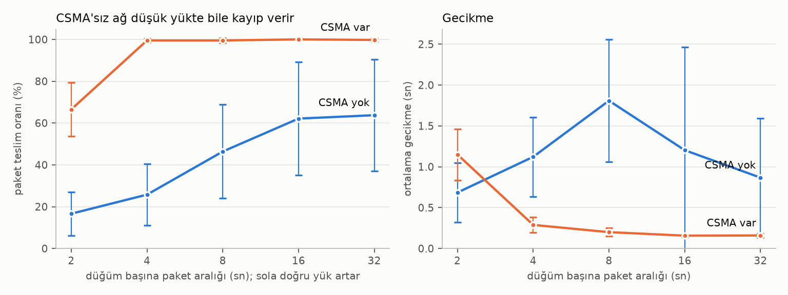
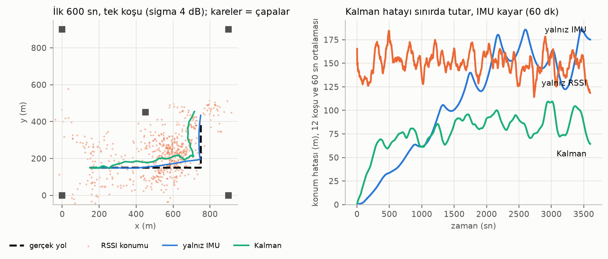
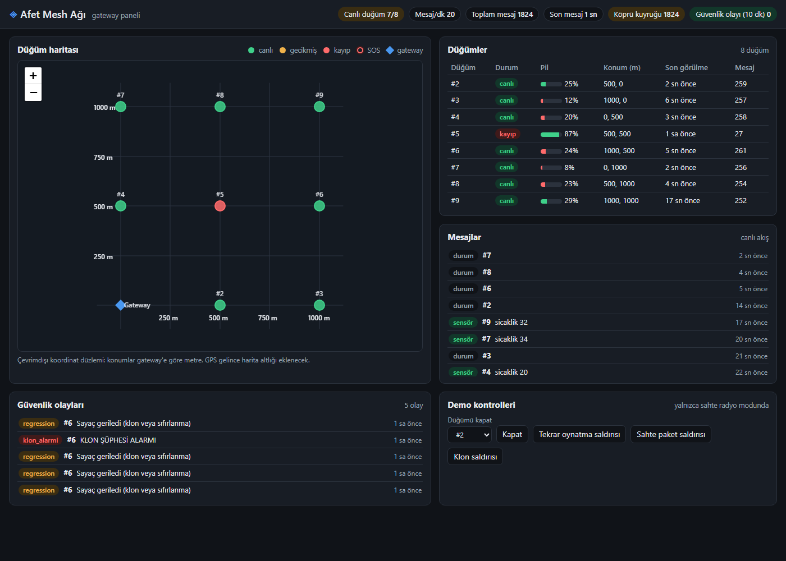

# Afet Mesh Ağı

LoRa tabanlı, kendini onaran afet iletişim ağı. Bilgisayar Mühendisliği bitirme projesi.

Baz istasyonu ve elektrik altyapısı çöktüğünde; STM32 saha/röle düğümleri çok hoplu mesh kurar, Raspberry Pi gateway verileri toplar ve dashboard'da gösterir. İnternet bulunduğunda veriler uzak sunucuya kayıpsız aktarılır.

## Özellikler (hedef)
- Çok hoplu, self-healing distance-vector yönlendirme (HELLO, ACK, RERR)
- AES-128 CCM ile şifreleme/doğrulama, replay koruması
- GPS'siz konum tahmini (RSSI + IMU + Kalman)
- Raspberry Pi gateway, SQLite, yerel dashboard
- Fırsatçı internet köprüsü (kalıcı kuyruk, çift kayıt önleme)

## Gerçekleme planı ve durum
Önce simülasyonda doğrulanır, sonra gerçek donanıma geçilir. Tam adım listesi: [docs/yol-haritasi.md](docs/yol-haritasi.md)

| Faz | İçerik | Durum |
|---|---|---|
| 0 | Python simülasyonu (adım 00-10) | **tamam** |
| 1 | Raspberry Pi gateway, sahte radyo (adım 11-16) | **tamam**; yazılım Raspberry Pi 4 üzerinde de çalışıyor |
| 2 | STM32 protokol çekirdeği, UART sahte radyo (adım 17-24) | **C çekirdeği tamam ve STM32F407 kartında doğrulandı**; kartlar arası UART bekliyor |
| 3 | Gerçek LoRa (adım 25-28) | bekliyor (modül siparişi gerekli) |
| 4 | GPS, TFT, ESP8266, IMU, enerji (adım 29-35) | bekliyor |
| 5 | Ölçüm, saha testi, rapor (adım 36-38) | bekliyor |

### Tamamlanan fazlar ve test sonuçları

#### Faz 0: Python simülasyonu (adım 00-10, tamam)
Protokol önce donanımsız, bilgisayarda tasarlanıp ölçülüyor. Simülasyon: düğümler 2D düzlemde, log-mesafe yol kaybı modeliyle RSSI, olay tabanlı zaman, gerçek LoRa airtime formülü ve %1 duty cycle sayacı.

| Adım | Modül | Ne yapar |
|---|---|---|
| 00 | repo, venv | Git/GitHub, Python ortamı, klasör iskeleti |
| 01 | `sim/mesh_sim.py` | Düğüm, RSSI, "kim kimi duyar" (menzil sınırı ≈ 1050 m) |
| 02 | `sim/engine.py`, `sim/lora.py` | Olay motoru, airtime hesabı, duty cycle sayacı |
| 03 | `sim/packet.py`, `neighbor.py`, `radio.py`, `node.py` | Paket formatı, radyo ortamı, HELLO ile komşu keşfi |
| 04 | `sim/routing.py` | Distance-vector (DSDV tabanlı) yönlendirme, RSSI'ya duyarlı maliyet |
| 05 | `sim/node.py` | DATA, TTL, çift paket bastırma, hop-hop ACK, sınırlı yeniden deneme |
| 06 | `sim/radio.py`, `node.py` | Çarpışma modeli, CSMA, üstel backoff |
| 07 | `sim/routing.py`, `node.py` | Yedek aday tablosu, histerezis, ACK hatası tespiti, RERR, iyileşme süresi |
| 08 | `sim/experiment.py` | Çok tekrarlı deneyler, CSV ve grafik üretimi |
| 09 | `sim/localization/` | GPS'siz konum: RSSI'dan mesafe, multilateration, IMU ölü hesap, Kalman filtresi |
| 10 | `sim/security.py` | AES-128-CCM (4 bayt etiket), sayaçtan nonce, replay reddi, klon/sayaç anomali alarmı |

Çalıştırma (proje kökünden, venv açıkken):
```
python -m sim.node          # yönlendirme, veri, ACK, CSMA ve self-healing deneyleri
python -m sim.experiment    # 10 tohumlu taramalar, docs/olcumler/ altına CSV (veri/) ve grafik (grafikler/)
python -m sim.localization.multilat   # RSSI ile konum (çapa sayısı ve gürültü taraması)
python -m sim.localization.fusion     # IMU + RSSI + Kalman, hata grafiği
python -m sim.security                # güvenlik senaryoları (sahtecilik, replay, klon)
python -m pytest sim/tests -q         # güvenlik birim testleri
```
Protokolün ayrıntısı: [docs/protokol.md](docs/protokol.md). Ham ölçümler: [docs/olcumler/veri/](docs/olcumler/veri/), grafikler: [docs/olcumler/grafikler/](docs/olcumler/grafikler/).

**Ana sonuçlar**

| Konu | Sonuç |
|---|---|
| LoRa airtime (20 bayt) | SF7: 56,6 ms, SF12: 1,319 s (≈ 23 kat); SF12'de %1 sınırı saatte en fazla 27 paket |
| Yol seçimi | RSSI'lı maliyet, zayıf doğrudan bağlantı yerine iki sağlam hop'u seçer; 96 yolluk taramada döngü yok |
| Hop-hop ACK (3 hop, %20 kayıp) | PDR %43,0 → %94,0 (%40 kayıpta %12,5 → %72,0); bedeli yeniden gönderim ve çift paket |
| Çarpışma (8 düğüm, eşzamanlı) | Çarpışma modeliyle PDR %21,7'ye düşer; CSMA ile %92,7, CSMA + ACK ile %99,4 |
| Yol kararsızlığı | Aday tablosu ve histerezisle hop değişimi 23-31'den 1'e düştü |
| İyileşme süresi (yalnız HELLO zaman aşımı) | Zaman aşımına (3 x HELLO periyodu) eşit: periyot 5 sn → 14,5 sn, 60 sn → 169 sn |
| İyileşme süresi (+ ACK hatası tespiti) | Periyottan bağımsız yaklaşık 5 sn (trafik varken) |
| Yük (CSMA ile, 8 düğüm) | Düğüm başına 4 sn'de bir pakette %99,5 teslim; 2 sn'de doyar (%66,5) |
| Yalnız RSSI ile konum (900 x 900 m, 5 çapa) | Gölgeleme 2 / 4 / 6 / 8 dB iken ortalama hata 88 / 158 / 219 / 266 m |
| IMU + RSSI + Kalman (sigma 4 dB, 60 dk) | Kalman hatayı sınırda tutar (≈ 50-150 m); yalnız IMU sapmaya bağlı olarak 40-200 m'ye kayar |
| Güvenlik: sahtecilik | Yükte 1 bit, kaynak adresi veya etiket değişince ya da yanlış anahtarla kare reddedilir; 20000 rastgele etiketin 0'ı kabul edildi |
| Güvenlik: replay ve sayaç | Aynı kare `dup`, eski kare `replay`; 16 bit sıra numarası taşması (65535 → 0) doğru çözülür; ek bayt maliyeti yok (etiket mevcut 4 bayt) |
| Güvenlik: yeniden başlatma ve klon | Kalıcı sayaç olmadan yeniden başlayan meşru düğüm klon gibi görünür (alarm); flash'a 64 karede bir yazan kalıcı sayaçla sorunsuz devam eder; geriden başlayan veya çok ileriden (>1024) başlayan klon reddedilir ve alarm verir |







**Bulgular**
- İyileşme süresi, arızanın nasıl fark edildiğine bağlıdır. Yalnız HELLO zaman aşımına güvenen ağda HELLO periyodu iyileşmeyi doğrudan belirler; ACK hatası tespiti bunu yaklaşık 5 sn'de tutar ve HELLO periyodunun uzatılmasına izin verir (60 sn'de HELLO'nun yayın payı %0,09).
- 5 sn'lik HELLO periyodu SF7'de yasal %1 yayın sınırını aşar (%1,03); periyot en az 10 sn seçilmeli.
- Yeniden deneme, kanal erişimi (CSMA) olmadan neredeyse fayda sağlamaz ve çarpışmaları 3 katına çıkarır; güvenilirlik ve kanal erişimi birlikte tasarlanmalı.
- RERR bu topolojilerde ölçülebilir ek kazanç sağlamadı (ACK hatası tespiti ve yedek adaylar yetiyor).
- Sayaç tabanlı güvenlikte kritik nokta yeniden başlatmadır: sayaç kalıcı olmazsa meşru düğüm klon gibi görünür. Kalıcı sayaç (flash'a seyrek rezerv yazımı) hem bunu hem flash aşınmasını çözer. Tam çözülmeyen sınır: anahtarı çalan bir saldırgan sayacı biraz ileri başlatarak meşru düğümü susturabilir.
- RSSI tek başına konum için yetersiz: gölgeleme gürültüsü mesafe tahminini çarpan olarak bozar (6 dB'de x1,48) ve hata yüzlerce metreyi bulur.
- Kalman filtresi, kaynaklardan birinden değil, ikisinin birleşiminden fayda sağlar: kısa sürede ve iyi bir IMU ile yalnız IMU daha iyidir; uzun sürede IMU sapar, RSSI sapmaz ama gürültülüdür, Kalman hatayı sınırda tutar. Filtre ayarı (q) IMU kalitesine uymalıdır.

**Bilinen sınırlar:** tek ortak ağ anahtarı, hop alanları (ttl, next_hop) doğrulanmaz ([docs/guvenlik.md](docs/guvenlik.md)); bağlantılar simetrik; hassasiyet eşiği SF'den bağımsız; saklı terminal çarpışmaları çözülmedi; sinyal modeli parametreleri varsayım, gerçek donanımda henüz doğrulanmadı; konum deneyinde IMU gürültüsü ve gölgeleme (zamanla ilişkili) modellenmiş değerlerdir, başlangıç noktası biliniyor kabul edilir.

**Faz 0 tamam.**

#### Faz 1: Gateway yazılımı, sahte radyo ile (adım 11-16 tamam)
Gateway'in yazılımı gerçek radyo olmadan, bilgisayarda geliştirildi ve sonra Raspberry Pi 4'e kuruldu. Simülasyondaki ağ, "sahte radyo" ile gateway'e gerçek bir LoRa radyosu gibi bağlanıyor: havadan gelen her paket güvenli bayt dizisine çevrilip alıcı servise veriliyor. Aynı kod Pi'de değişiklik olmadan çalıştı ([docs/kurulum/pi-kurulum.md](docs/kurulum/pi-kurulum.md)).

| Adım | Modül | Ne yapar |
|---|---|---|
| 11 | `docs/kurulum/pi-kurulum.md`, `gateway/deploy/` | Pi 4 kurulumu ve systemd hizmet dosyaları (uygulandı: testler geçti, panel hizmeti çalışıyor) |
| 12 | `gateway/receiver/`, `sim/wire.py` | Paket çözücü, doğrulama (AES-CCM), uygulama yükü, SQLite şeması, ACK üretimi |
| 13 | `gateway/mockradio.py` | Sahte radyo: simülasyonu gateway'e besler, saldırı ve arıza enjekte eder |
| 14 | `gateway/dashboard/app.py` | FastAPI sunucusu: düğüm, mesaj, alarm, sağlık özeti, canlı akış (SSE) |
| 15 | `gateway/dashboard/static/` | Tarayıcı paneli: çevrimdışı harita, düğüm listesi, canlı mesaj ve güvenlik akışı |
| 16 | `gateway/bridge/`, `remote-server/` | Fırsatçı internet köprüsü: kalıcı kuyruk, bağlantı izleyici, uzak sunucu, çift kayıt önleme |

Çalıştırma (proje kökünden, venv açıkken):
```
python -m gateway.mockradio                       # sahte radyo ile veri akışı ve saldırı denemeleri
python -m gateway.dashboard.app --demo            # paneli aç: http://127.0.0.1:8000 (canlı demo)
python -m gateway.bridge.demo                     # internet kes/aç ve köprü çökmesi demosu
python -m pytest gateway/tests sim/tests -q       # 38 birim test
```



**Ana sonuçlar**

| Konu | Sonuç |
|---|---|
| Sahte radyo, 3x3 ızgara, 300 sn | 115 rapor gönderildi, 112'si gateway'e ulaştı; veritabanındaki mesaj sayısı simülasyondaki gateway ile birebir aynı (112) |
| Yeniden gönderimler | 16 özdeş kare `dup` olarak ayrıldı, çift kayıt yok, yanlış alarm yok (297 HELLO, 112 DATA geçerli) |
| Saldırı enjeksiyonu (tekrar oynatma, sahte etiket, klon) | 0 mesaj eklendi; `replay`, `bad_tag`, `regression` ve `klon_alarmi` olayları kaydedildi |
| Düğüm arızası (düğüm 5 kapatıldı) | Panelde durum "canlı" → "gecikmiş" → "kayıp"; kalan 7 düğüm raporlamaya devam etti |
| Köprü: internet 120-300 sn arası kesik | Kuyruk 0 → 148 mesaja çıktı, bağlantı gelince boşaldı |
| Köprü: yükleme sırasında çökme (t = 330 sn) | Sunucu 7 mesajı almıştı ama işaretlenmemişti; yeniden başlayan köprü tekrar yolladı, sunucu 7 çiftin hepsini reddetti |
| Köprü uçtan uca (480 sn) | Gateway'de 375, uzak sunucuda 375 mesaj, kuyrukta 0: kayıp yok, çift yok |
| Köprü geri çekilme (sunucu 500 döndürürse) | Bekleme 2, 4, 8, 16 sn (üstel), bağlantı gelince sıfırlanır |
| Raspberry Pi 4 (4 GB, 64 bit) üzerinde | 40 birim test geçti; panel SSH tüneliyle tarayıcıdan açıldı; panel hizmeti (systemd) açılışta kendiliğinden başlıyor; güç kontrolü temiz (`get_throttled=0x0`) |

**Bulgular**
- Radyo seviyesinde aynı paketin birden çok kopyası normaldir (yeniden gönderim). Kopya ile tekrar oynatma saldırısını ayırt etmek için zaman penceresi kullanıldı: 30 sn içinde gelen özdeş kare `dup`, daha sonrası `replay`. Pencere olmadan normal çalışmada yanlış alarm veriyordu.
- Veritabanı kayıt kimliği `kaynak:sayaç` olduğundan aynı mesaj ikinci kez eklenemez; köprü kuyruğu ve uzak sunucu da aynı kimlikle çift kaydı önler. Güvenilirlik "en az bir kez gönderim + tekil kayıt" ile sağlanır.
- Köprü, sunucu "aldım" demeden kaydı işaretlemez; çökme olursa en kötü ihtimalle tekrar yollanır, kaybolmaz.
- Gateway yeniden başlarsa sayaçlar korunmazsa iki sorun çıkar: tekrar oynatma penceresi yeniden açılır ve gateway'in ACK/HELLO sayaçları geri dönüp düğümler tarafından reddedilir (firmware testlerinde ölçüldü: kalıcı olmadan düğümler boşuna yeniden dener, kalıcıyla yeniden gönderim 0).
- Panel tarayıcıdan yalnızca yerel dosyalarla çalışır (harita altlığı internetten gelmez), yani afet anında internet olmadan açılır.

**Sınırlar:** gerçek LoRa radyosu henüz yok (sahte radyo simülasyon çıktısıdır); gateway güvenlik sayaçları ve ACK/HELLO sayaçları SQLite'ta kalıcıdır (yeniden başlatmada korunur, SD kart aşınmasını azaltmak için en çok 5 sn'de bir toplu yazılır); konumlar GPS değil, düğümlerin bildirdiği koordinatlardır; uzak sunucu tek kullanıcı API anahtarıyla korunur ve TLS yoktur (demo).

**Sıradaki:** Faz 2, STM32 protokol çekirdeği: önce bilgisayarda derlenen donanımdan bağımsız C kodu (paket serileştirme, HELLO, yönlendirme) ve Python ile uyum testleri, ardından kartlarda UART üzerinden sahte radyo.

#### Faz 2: STM32 protokol çekirdeği, bilgisayarda doğrulanan kısım (adım 18-24'ün donanımsız bölümü)
Protokol, STM32'ye taşınacak donanımdan bağımsız C koduna (`firmware/core/`) çevrildi. Kod hiçbir kart özelliğine dokunmaz; radyo, zaman ve rastgelelik küçük bir arayüzle (`afet_radio_if_t`) dışarıdan verilir. Bu yüzden aynı kod bilgisayarda Python simülasyonunun içinde, sonra kartlarda çalışır. Kartlara yazma, UART sahte radyo, flash'ta kalıcı sayaç ve donanım zamanlayıcısı kartlar elimize geçince yapılacak.

| Adım | Dosya | Durum |
|---|---|---|
| 17 | `firmware/drivers/f407disc/`, `firmware/apps/`, `scripts/` | Kart desteği (başlangıç kodu, bağlayıcı betiği, 168 MHz saat, LED, düğme, SysTick, çevrim sayacı), derleme ve yükleme betikleri, RAM tamponundan log okuma; kartta LED denemesi ve öz-sınama çalışıyor (SWV ve iki kart arası UART bekliyor) |
| 18 | `node.h` (`afet_radio_if_t`), `framing.c`, `drivers/f407disc/uart.c`, `apps/uartnode` | Radyo arayüzü, SLIP çerçeveleme, USART2 sürücüsü ve UART sahte radyo hazır; tek kartta iç döngü kartta doğrulandı, iki kart arası kablolu deneme bekliyor ([docs/kurulum/stm32-kart.md](docs/kurulum/stm32-kart.md)) |
| 19 | `wire.c` | Tamam: Python ile bayt bayt aynı |
| 20-21 | `routing.c`, `node.c` | Tamam: HELLO, yönlendirme tablosu, iletme, ACK, yeniden deneme, çift paket bastırma |
| 22 | `node.c` | Arıza tespiti (ACK hatası, HELLO zaman aşımı, RERR) simülasyonda doğrulandı; 3-4 kartta zincir testi kartlarla |
| 23 | `aes128.c`, `ccm.c`, `security.c` | AES-128-CCM, sayaç, replay ve klon tespiti tamam; donanım RNG ve flash'ta kalıcı sayaç kartta |
| 24 | `lora_time.c` | Airtime ve duty cycle sayacı tamam; donanım zamanlayıcısına bağlama kartta |

Çalıştırma (proje kökünden, venv açıkken; derleme için `gcc` aranır, yoksa testler atlanır):
```
python -m pytest firmware/tests -q          # C kodunu derler ve Python ile karşılaştırır (19 test)
python -m pytest gateway/tests sim/tests firmware/tests -q   # tüm testler (59)
```

**Ana sonuçlar**

| Konu | Sonuç |
|---|---|
| Paket biçimi (C ve Python) | 300 rastgele paket bayt bayt aynı; hatalı paketler aynı şekilde reddedilir |
| AES-128-CCM | 400 rastgele (anahtar, nonce, başlık, yük) için `cryptography` kütüphanesiyle aynı şifreli metin ve etiket; bozuk etiket reddedilir |
| Güvenlik alıcısı | 15 tohum x 500 rastgele olay (kopya, geç gelen, sahte, klon, sayaç atlaması): C ve Python her adımda aynı kararı verir |
| Yönlendirme tablosu | 30 tohum x 300 işlem: aynı yol, maliyet, sıra numarası ve değişim sayısı |
| Airtime ve duty cycle | 288 ayar kombinasyonunda formül farkı < 1e-12; 4000 işlemde duty cycle kararları aynı |
| Testlerin gücü | C koduna bilerek hata eklenince (geç pencere 32 → 16, bağlantı maliyeti eşiği) testler başarısız oldu |
| Bellek | Düğüm durumu 19,4 KB RAM, kod yaklaşık 5,6 KB flash (-Os); STM32F407'de 192 KB RAM / 1 MB flash var |
| Cortex-M4 derlemesi | STM32CubeIDE araç zinciriyle `-Wall -Wextra -Werror` uyarısız derleniyor |
| C düğümleri simülasyonda, 400 m zincir, %20 kayıp | PDR: yeniden denemesiz %44,0 (Python %43,0), 3 denemeyle %98,5 (Python %94,0) |
| C düğümleri, yönlendirme | Zincir ve 3x3 ızgarada Python düğümleriyle aynı yol uzunluğu ve maliyet |
| C düğümleri, self-healing (3x3 ızgara) | Yalnız HELLO: 13-14 sn (Python 14,5); ACK hatası tespitiyle 3,4-4,5 sn (Python 4,2) |
| Uçtan uca güvenlik (C) | 4 düğümlü zincirde 10/10 şifreli paket gateway'e ulaştı; tekrar oynatma, sahte etiket ve değiştirilmiş yük reddedildi |
| **STM32F407 kartında öz-sınama** | C çekirdeği kartta Python vektörleriyle karşılaştırıldı: paket biçimi, AES-CCM (altı vektör), yönlendirme (80 işlem), güvenlik alıcısı (15 olay, klon alarmı) **hepsi geçti** |
| AES-CCM süresi (168 MHz) | 20 baytlık kareyi mühürlemek 287 us, doğrulayıp çözmek 288 us (AES blok 39 us); röle için tam doğrulama 305 us. SF7'de aynı karenin havada kalma süresi 71,9 ms: şifreleme maliyeti havadaki sürenin %0,4'ü |
| Yönlendirme güncellemesi (kartta) | HELLO ilanı başına 2 us |
| **6 düğümlü ağ tek kartta** (yazılım radyosu, elmas topoloji, 200 sn sanal zaman) | Yol 11 sn'de öğrenildi; arızadan önce 25/25, düğüm 3 (yoldaki düğüm) kapatılınca iyileşme **4,1 sn**, arızadan sonra 14/15 teslim; son yol 6 > 2 > 1. Python'daki C düğümleriyle (3,4-4,5 sn) uyumlu. Tüm ağı 200 sn'lik sanal sürede koşmak işlemcide 337 ms sürdü (gerçek zamandan 590 kat hızlı) |
| UART sahte radyo (tek kartta iç döngü) | USART2 115200 bayt/sn, SLIP çerçeveleme: 43 kareden 42'si alındı (sonuncusu yoldaydı), bozuk çerçeve 0, taşma 0; düğüm 2 yolu `1 maliyet 1` öğrendi, 9 raporun 9'u gateway'e teslim, 9 ACK, yeniden gönderim 0 |
| Gerçek zamanlı kart demosu | Kartta 6 düğümlü ağ gerçek zamanda çalışır: yeşil LED her gateway teslimatında, turuncu yeniden gönderimde, mavi yol değişince yanar; USER düğmesi yoldaki düğümü kapatır/açar (kırmızı LED), sayaçlar korunarak |

**Bulgular**
- Güvenli protokolde sıra numarası, çerçeve sayacının alt 16 bitidir; bu yüzden ACK'in hangi paketi onayladığı başlıkta değil yükte taşınır (3 bayt). ACK 13 değil 15 bayt olur, HELLO 16 bayttır.
- Çok sekmeli ağda paketler sıra dışı gelebilir; geri kalan 32 sayaçlık "geç kabul" penceresi olmadan meşru paketler klon sanılırdı (Python tarafı da buna göre düzeltildi).
- Python simülasyonu ile C kodunun aynı testten geçmesi, STM32'ye geçişte davranışın bozulmayacağına dair güçlü bir kanıttır; kartlarda yalnızca donanıma özgü kısımlar (zamanlayıcı, UART, flash, RNG) doğrulanacak.

**Sınırlar:** bu bölüm yalnızca bilgisayarda doğrulandı; AES-CCM'in STM32'deki süresi, kesme/zamanlayıcı bağlantısı ve flash yazımı ölçülmedi; zaman sayacı 32 bit milisaniyedir (49 gün sonra taşar, uzun süreli çalışma için düzeltilecek); yönlendirme tablosu 8 aday, güvenlik tablosu 16 kaynak ile sınırlı.

**Radyo kararı (Faz 3):** lehim gerektirmeyen Ra-02 (SX1278, 433 MHz) seçildi. Yasal çerçeve BTK Tablo-1 madde 15a: 433,05-434,79 MHz, 10 mW e.r.p., %10 görev çevrimi; sürücü gücü 10 dBm'e ve taşıyıcıyı bu banda kısıtlar. Simülasyon parametreleri 433 MHz'e göre güncellendi (TX 10 dBm, 1 m yol kaybı 25,2 dB, duyarlılık -125 dBm; menzil yaklaşık 1,3 km). SX127x sürücüsü (`firmware/drivers/sx127x/`) yazmaç düzeyinde sahte çipte test edildi (18 test); bağlantı planı [docs/kurulum/ra02-baglanti.md](docs/kurulum/ra02-baglanti.md).

**Sıradaki:** iki kart arası UART denemesi, Ra-02 gelince kartta iki düğüm arası ilk LoRa mesajı ve radyo ölçümü.

## Klasörler
| Klasör | İçerik |
|---|---|
| `sim/` | Python simülasyonu, konum prototipi, testler |
| `firmware/` | STM32 kodu; donanımdan bağımsız protokol çekirdeği |
| `gateway/` | Raspberry Pi: alıcı, dashboard, köprü |
| `remote-server/` | Uzak sunucu demosu |
| `hardware/` | Malzeme listesi ([PDF](hardware/malzeme-listesi.pdf)), şemalar |
| `docs/` | Protokol, güvenlik, yol haritası, kurulum, ölçümler, proje raporu (dizin: [docs/README.md](docs/README.md)) |
| `scripts/` | Yardımcı betikler |

## Kurulum (simülasyon)
```
python -m venv venv
# Windows: venv\Scripts\activate    Linux: source venv/bin/activate
pip install -r requirements.txt
```

## Yazarlar
Ayşe Akdoğan, Melih Ali Çağman — Danışman: Prof. Fecir Duran
